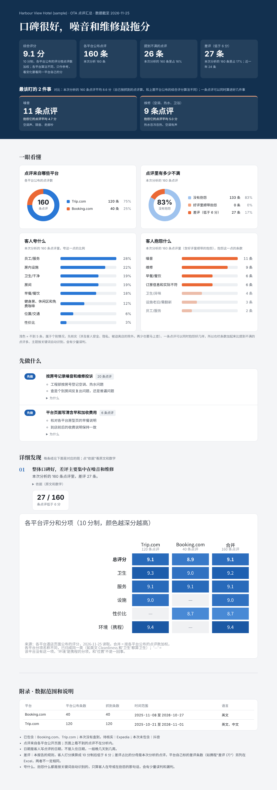

# Hotel Review Analysis

**An open-source skill that turns a hotel's guest reviews from many booking platforms into one easy-to-read report.** It collects your own hotel's reviews (Ctrip/Trip.com, Meituan, Fliggy, Booking.com, Agoda; Expedia scores only), merges every platform into one summary, and writes a web page (saveable as PDF) with the conclusion and what to do first at the top, then charts: overall rating, what guests praise and complain about, main guest groups, foreign-language reviews, low-score reviews one by one, recurring problems and recent change.



*The sample above uses invented data for a fictional hotel. The report, Excel and charts are in English; review text stays in its original language.*

## What it does

- **One combined rating** weighted by each platform's published review count (Ctrip and Trip.com are the same reviews, counted once)
- **Complaint themes**: 12 fixed themes with Chinese and English keywords (noise, repairs, hygiene, staff, breakfast, "booking info does not match reality" and more), counted only where guests are unhappy
- **What guests praise**, with basics (service, cleanliness) separated from real selling points
- **Main guest groups** and what each group mentions most, as the basis for listing copy
- **Low-score reviews one by one** (cause, what the hotel did, result), and whether a problem keeps coming back
- **Recent change**: last 90 days against 91 days to one year ago, with sample-size warnings
- **Actions ranked** as now / first / later / verify first, each with the number of reviews behind it
- Single hotel only. It does not analyse or recommend competitors

Design choices: low score = below 6 out of 10 (below 3 out of 5), no "good/medium" split; top-up low-score reviews are only evidence quotes and never enter a ratio or chart; no conclusion without a number you can check in Excel; no reviewer nicknames.

## Quick start (no account needed)

```bash
pip install -r requirements.txt            # pandas, openpyxl, matplotlib (a CJK font is needed so Chinese review text and room types show in charts)
python tests/test_core.py                  # should end with the all-passed line
python scripts/analyze.py examples/sample_project
python scripts/report.py  examples/sample_project
# open examples/sample_project/review_report_*.html in your browser
```

PDF (optional): `npm i playwright`, then `node scripts/to_pdf.js <absolute path to the .html> <output.pdf>`.

With your own hotel: let an AI assistant that can drive a browser and run Python follow `skill/SKILL.md`. It finds your hotel on each platform, collects the reviews with the scripts in `scripts/`, writes `summary.json` and `conclusions.json`, and builds the report. Keep your data folder outside this repository. Data formats are in `docs/DATA_FORMAT.md`.

## Platforms

| Platform | What is read | Status |
|---|---|---|
| Ctrip (full text read from Trip.com, summary from the mainland site) | reviews, scores, sub-scores, tags | Author-tested |
| Booking.com | reviews, sub-scores | Author-tested |
| Agoda | reviews, sub-scores, platform topics | Author-tested |
| Meituan | reviews, stars, tags (you log in yourself) | Author-tested, rate-limited if paged fast |
| Fliggy | reviews, sub-score stars (you log in yourself) | Author-tested |
| Expedia | scores only | Reviews cannot be opened automatically |
| A short-video app | none | Not included (no hotel page on the web version) |

If your hotel is not on a platform, the report says "not found this time, to be verified" (ask the hotel whether it is listed).

## Language

Review keywords cover Chinese and English. The report, Excel and charts are written in English; the Chinese keyword lists in `scripts/analyze.py` are needed to read Chinese reviews. To produce another output language, translate the labels in `scripts/analyze.py`, `scripts/charts.py` and `scripts/report.py`. Pull requests are welcome.

## Risks, in plain words

Collecting reviews automatically may be restricted by a platform's terms, and platforms may limit or block accounts that load pages too fast. The scripts stop at a login page or human check and never try to bypass it; you log in yourself and you decide what to collect and how often. You are responsible for following the terms of any site you use. The authors give no warranty (see `LICENSE`).

## Contributing

Pull requests are welcome: fixes when a platform changes its page, other platforms, translations, report improvements. Read `CONTRIBUTING.md`. Questions and ideas: open an issue.

## About the author

**Oriental Horizon Hospitality** helps hotels and the people who run them do better business, in China, Southeast Asia and beyond. The founder has 13 years in hotel revenue management with Hilton, IHG, Accor and Hyatt, and was Director of Revenue at a five-star hotel in Singapore.

**What we do**

- **Consulting**: business diagnosis, pricing and distribution for independent and branded hotels
- **Hands-on coaching**: we work alongside owners and teams until the changes actually work
- **Training**: practical training open to anyone in hospitality, from owners and hotel teams to students, including how to use AI in daily work
- **Open source**: free AI skills for hotels, open for anyone to use and adapt

**Operating track record**: our company took over a four-star hotel in a tier-3 Chinese city and turned an annual loss of about RMB 1.8M into a profit of about RMB 2M the following year. The founder also ran a seaside guesthouse that was the market leader in its local market for five consecutive years.

**Free consultation: tell us your situation and we will tell you honestly whether we can help.**

- LinkedIn: https://www.linkedin.com/in/ludan-zhang54/
- GitHub: https://github.com/ludanzhang54
- WeChat: Oriental_Horizon
- WhatsApp: +65 86796635
- Email: ludanzhang54@gmail.com
- YouTube (Chinese-language videos and podcast): https://www.youtube.com/@TheHotelBusiness
- Podcast, English: *The Hotel Business* - https://rss.com/podcasts/the-hotel-business/
- Podcast, Chinese: *张小姐看酒店生意* ("Hotel Business with Ms. Zhang") - search this name on Xiaoyuzhou, Apple Podcasts, Ximalaya or YouTube

## Licence

MIT. Free to use, change and share, including commercially. See `LICENSE`.
